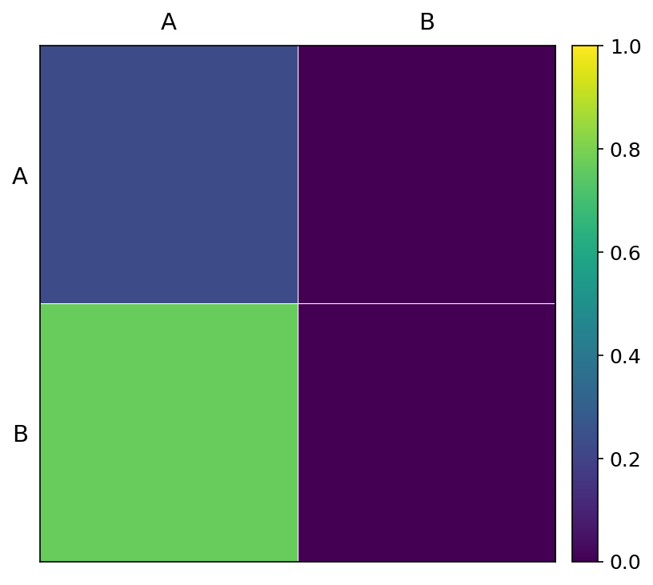

Results and figures
===================

Files written by MONpy
----------------------

.. list-table::
   :header-rows: 1
   :widths: 38 62

   * - File
     - Contents
   * - ``monpy_results.txt``
     - Input file, fragment definitions, energies, oscillator strengths,
       CI configuration counts and squared amplitudes summed over the expansion,
       raw and normalized fragment matrices, and CT and LE descriptors.
   * - ``CT_<spin>_<state>.png``
     - Heatmap of normalized fragment weights, with the same scale from 0 to 1
       for all states with defined fractions.
   * - ``TDM_AO_<spin>_<state>.npy``
     - Optional signed AO transition matrix before fragment aggregation.

Interactive mode writes to the current directory. Configuration mode writes
to the TOML file's ``output_dir`` and also creates ``estados.csv`` with one row
per selected state. The CSV records normalized fractions under ``P[i,j]``
using the one-based fragment order listed in the text report. If CT cannot
be computed, the report and CSV record the reason. File names use NDOL state
numbers.

Read the matrix
---------------

Column labels are at the top and row labels are on the left. The diagonal
runs from the top left to the bottom right. A diagonal cell represents an
excitation within one fragment. An off-diagonal cell at row B and column A
represents a hole in B and an electron in A, or the direction B → A.

   Singlet 9 of the ``CONTCAR_n2SD`` dimer at 3.9278 eV. The lower-left cell
   contains 76.62% of the total normalized weight. The two off-diagonal cells
   together give a CT weight of 76.63%.
